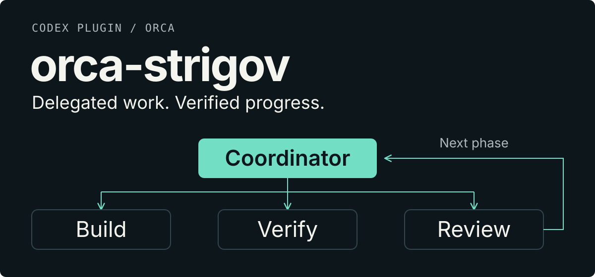

<p align="center">
  <a href="./README.md">English</a> · <a href="./README.ru.md">Русский</a>
</p>

> [!CAUTION]
> **REMOVE THE NATIVE ORCA SKILLS BEFORE ENABLING THIS PLUGIN.**
>
> Remove the old **`orca-cli`** and **`orchestration`** skills, plus any standalone
> **`orca-dev`**, from your active skill catalog. This is **mandatory**, not optional:
> loading both instruction stacks creates conflicting coordinator instructions.
> Keep the replacements bundled inside `orca-strigov`. **Do not remove Orca itself,
> its CLI or its runtime hooks.** See [the mandatory cleanup step](#0-remove-the-native-orca-skills--mandatory).

<p align="center">
  
</p>

**A Codex and Claude Code plugin for supervised, multi-model development in [Orca](https://orca.dev).**
Describe the outcome; the coordinator delegates the work, checks the evidence and
carries the plan across phases. Three skills, one shared role contract.

For engineers and vibe coders who want more than a single agent's “done.”
This is a local workflow using your model CLIs, not a hosted no-code service.

[Install](#install) · [First use](#first-use) · [Checks and evidence](#checks-and-evidence)

> **Historical runtime baseline:** four CI jobs passed on macOS, Linux and native Windows
> PowerShell 5.1 / 7. [Inspect the run at `5d22ac4`](https://github.com/strigov/orca-strigov/actions/runs/35422197544).
> These are isolated integration tests, not a live Orca acceptance run.
> For the dual-host version, see [current CI](https://github.com/strigov/orca-strigov/actions/workflows/runtime.yml)
> and [host adapter details](docs/host-adapters.md).

## One request, several accountable roles

```text
$orca-dev Implement password reset.
Use email links that expire
after 15 minutes. Support mobile.
Add tests and user documentation.
```

1. **Plan** — a worker studies the repository; a separate reviewer checks the plan.
2. **Build** — an implementer changes code and tests for one authorized phase.
3. **Verify** — a gate worker runs declared commands and preserves their full logs.
4. **Review** — independent model families inspect the candidate; findings feed a bounded fix loop.
5. **Advance or finish** — the coordinator records accepted work and starts the next
   authorized phase. Final completion requires its own evidence.

A completed worker is not a completed phase. A committed phase is not a completed plan.
The coordinator owns dispatch, evidence reconciliation and Git bookkeeping;
implementation belongs to workers.

## Three skills, one policy

| Skill | Responsibility |
| --- | --- |
| [`orca-dev`](skills/orca-dev/SKILL.md) | Development phases, verification and acceptance |
| [`orchestration`](skills/orchestration/SKILL.md) | Worker assignments, messages and lifecycle |
| [`orca-cli`](skills/orca-cli/SKILL.md) | Orca terminals, worktrees and runtime operations |

The bundle replaces the stock `orchestration` / `orca-cli` instructions and the
standalone `orca-dev` skill. Their [shared role contract](skills/orchestration/role-contract.md)
keeps a coordinator from treating “continue” or a phase boundary as a new role.
Workers follow their live assignment without restarting the coordinator workflow.

**Replace the competing instructions, not Orca itself.** Keep its CLI, runtime
hooks, orchestration, messaging and terminal identity.

## Install

### Prerequisites

Install [Orca](https://orca.dev) with orchestration enabled, Git **2.36+**, and the
worker CLIs: **Codex CLI, Claude Code and Antigravity CLI (`agy`)**. Sign in to each.
The exact role/model mapping lives only in [`roles.md`](skills/orca-dev/roles.md).

| Platform | Runtime requirements |
| --- | --- |
| macOS | Bash 3.2+ and Python 3.13+ |
| Linux | Bash 3.2+ and Python 3.9+ |
| Native Windows | PowerShell 5.1 or 7; Windows 10 1709+ and a filesystem supporting POSIX rename (NTFS) |
| WSL2 | Linux runtime; Orca and model CLI availability depend on the environment |

Claude coordinator hooks additionally require **Node.js 18+** on every platform.
Packaging baselines: **Codex CLI 0.155.0**, **Claude Code 2.1.278**.
Native Windows helpers do not require Python, Bash or jq. The personal-marketplace
registration scripts use Python separately.
See [Windows setup](docs/install-windows.md) for shell and filesystem details.

### 0. Remove the native Orca skills — mandatory

Before enabling the plugin:

- Remove the old native **`orca-cli`** and **`orchestration`** entries and any
  separately installed **`orca-dev`**. Check user-level and project-level
  `.agents/skills/`, `.codex/skills/`, `.claude/skills/` and other enabled plugins.
- Preserve a backup **outside every skill-discovery directory**. Renaming a
  folder to `*-backup` inside a scanned directory does not remove the conflict.
  Remove only the old entries, not shared skill directories or symlink targets.
- Keep all three replacement skills **inside `orca-strigov`**. Keep Orca,
  its CLI and runtime hooks. Other native integrations are not removed by this step.

**Do not continue until the old entries are no longer discoverable.** Recheck
after Orca integration updates: they may restore the native skill entries.
See [safe removal and rollback](docs/install-plugin.md#remove-the-instruction-conflict-not-the-runtime).

### 1. Get the whole plugin

```sh
git clone https://github.com/strigov/orca-strigov.git
cd orca-strigov
```

Keep `plugin.json`, hidden `.codex-plugin/` and `.claude-plugin/`, all three `skills/`, `hooks/` and
`bin/` together. Copying one `SKILL.md` is not an installation.

<details>
<summary>ZIP distribution</summary>

When a plugin release is published, its [release assets](https://github.com/strigov/orca-strigov/releases)
are named `orca-strigov-<version>.zip` and `orca-strigov-<version>.zip.sha256`.
Extract the complete `orca-strigov/` folder, including hidden files.
Old `orca-dev-*.zip` archives contain the standalone skill, not this plugin.

</details>

### 2. Register the plugin

After mandatory cleanup, install from the appropriate marketplace.

Codex:

```sh
codex plugin marketplace add https://github.com/strigov/strigov-codex-plugins.git
codex plugin add orca-strigov@strigov-codex-plugins
```

Claude Code:

```text
/plugin marketplace add https://github.com/strigov/strigov-cc-plugins.git
/plugin install orca-strigov@strigov-cc-plugins
```

If that marketplace is already registered, use its existing registration.
Private plugin sources still require GitHub access. Follow
[Install and migrate](docs/install-plugin.md) for local installation, hook trust
and rollback. For a local checkout you can ask Codex:

> Use plugin-creator to install the complete Orca Strigov plugin from
> `<absolute checkout path>` into my personal marketplace. Show duplicate skills
> before changing them. Preserve Orca's runtime hooks and do not bypass hook trust.

Confirm that **step 0 is complete** before enabling the plugin. Review and trust
its hooks, then start a **new session in the chosen host**. The three skills must resolve from
`orca-strigov`, without old native or standalone copies alongside them.

### 3. Check your project

From the plugin folder, use the command for your platform. These checks are read-only:

```bash
./install.sh --check "/path/to/your/project"
```

```powershell
.\install.ps1 -Check "C:\path\to\your\project"
```

`OK` means ready; `INFO` is context; `WARN` requires attention.
Warnings produce exit code `1`.

If repo trust is missing, explicitly grant it with
`./install.sh --repo "/path/to/your/project"` or
`.\install.ps1 -Repo "C:\path\to\your\project"`.
These commands change Claude/Antigravity trust for that project and its worktrees.

**The prerequisite scripts do not register the plugin.** Do not use
`--legacy-skill` / `-LegacySkill` alongside it, and do not assume `git pull`
refreshes Codex's installed plugin cache.

## First use

1. Open your app's repository in Orca and start a new Codex or Claude Code session.
2. Confirm all three skills resolve from this plugin and its hooks are trusted.
3. Send the request from the example above. Inside an Orca terminal an
   implementation request activates `orca-dev` without the explicit skill tag;
   outside Orca (desktop Codex, a plain terminal) only `$orca-dev` does.

Claude's explicit command is `/orca-strigov:orca-dev <task>`. Choose one
development coordinator for an objective; do not run another orchestration plugin's
pipeline on the same work. See [host differences](docs/host-adapters.md).

Worker terminals appear in Orca as the coordinator dispatches work. Give it
the intended user, desired result, constraints and acceptance criteria.
It should continue through already authorized phases, asking when a product
decision, access or new permission is needed. An explicit pause remains a pause.

Before relying on a new installation, run the
[disposable two-phase smoke check](docs/install-plugin.md#smoke-check-before-relying-on-it).

## What the hooks enforce — and what they do not

For a **bound development session with trusted hooks**, the guard restores the
coordinator role on start/resume, rejects direct source/test edits through covered
editing tools, and rejects a premature Stop with the pending action.
Completion is checked against current Git and artifact facts, not a summary.

The hooks are **guardrails, not a security sandbox or a guarantee of model behavior**:

- They do not cover arbitrary shell/MCP writes, dishonest local-state changes or unbound sessions.
- They do not override user interruption, provider limits or missing authority.
- They do not dispatch workers themselves. Repeated no-progress stops lead to a
  bounded escalation that reports incomplete work, not success.

See the [session contract](skills/orca-dev/coordinator-session.md) for exact coverage.
General non-development orchestration follows the shared policy, not the Git-backed guard.

## Checks and evidence

Historical pre-dual-host snapshot: **2026-09-19**, commit [`5d22ac4`](https://github.com/strigov/orca-strigov/commit/5d22ac4f94ed8f43175068ab5cd2b57c86ebce72).
The [four-job CI run](https://github.com/strigov/orca-strigov/actions/runs/35422197544)
preserves environment logs and test artifacts.

| Environment | Integration suite |
| --- | --- |
| macOS · Python 3.13 | PASS · 132 tests, no skips |
| Ubuntu · Python 3.9 | PASS · 132 tests, 1 platform skip |
| Windows · PowerShell 5.1 | PASS · 132 tests, 4 platform skips |
| Windows · PowerShell 7 | PASS · 132 tests, 4 platform skips |

Counts include skipped cases. Both Windows jobs also passed four directed regressions.
The suite exercises shared positive/negative fixtures, evidence binding, phase
continuation, role restoration, installation and packaging. Synthetic Orca inputs
do **not** certify a real multi-phase provider session or plugin installation.

The [plugin conversion report](docs/plugin-validation.md) records the earlier
local validation. Its unrun-platform notes belong to that run; the CI snapshot
above supplies later platform evidence. Live Orca acceptance remains separate.

## Go deeper

- [Install, migrate, update and roll back](docs/install-plugin.md)
- [Development protocol and role matrix](skills/orca-dev/SKILL.md)
- [Runtime contracts](skills/orca-dev/runtime-contracts.md) and [platform notes](docs/runtime-platforms.md)
- [Repository maintenance rules](AGENTS.md)
- [Bundled upstream material and notices](THIRD_PARTY_NOTICES.md)

<details>
<summary>Repository map</summary>

```text
.codex-plugin/          plugin manifest
skills/                orca-dev, orchestration and orca-cli
hooks/                 role and continuation hooks
bin/                   POSIX and native PowerShell helpers
tests/                 isolated integration and maintenance tests
docs/                  installation, contracts and validation history
assets/readme/         English and Russian SVG covers
install.sh / .ps1       prerequisite and repo-trust checks
```

</details>
