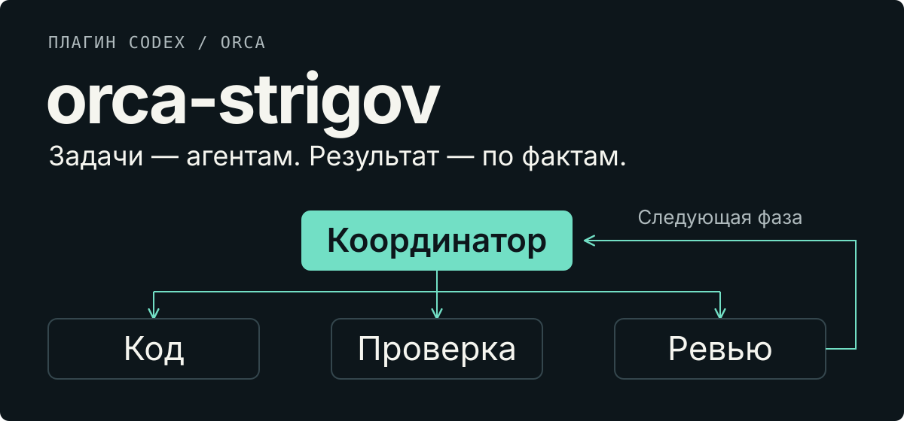

<p align="center">
  <a href="./README.md">English</a> · <a href="./README.ru.md">Русский</a>
</p>

> [!CAUTION]
> **ПЕРЕД ВКЛЮЧЕНИЕМ ПЛАГИНА УДАЛИТЕ НАТИВНЫЕ СКИЛЛЫ ORCA.**
>
> Удалите из активного каталога старые **`orca-cli`** и **`orchestration`**, а также
> отдельно установленный **`orca-dev`**, если он есть. Это **обязательный шаг**, а не
> рекомендация: одновременная загрузка двух наборов создаёт конфликт инструкций координатора.
> Скиллы, входящие в `orca-strigov`, оставьте. **Саму Orca, её CLI и runtime-hooks
> удалять нельзя.** См. [обязательный шаг очистки](#0-удалите-нативные-скиллы-orca--обязательный-шаг).

<p align="center">
  
</p>

**Плагин Codex и Claude Code для управляемой разработки несколькими ИИ-моделями в [Orca](https://orca.dev).**
Вы описываете результат; координатор делегирует работу, сверяет доказательства
и ведёт план через все фазы. Три скилла, одни правила ролей.

Для инженеров и вайбкодеров, которым недостаточно «готово» от одного агента.
Это локальная работа через ваши CLI моделей, а не облачный no-code-сервис.

[Установка](#установка) · [Первый запуск](#первый-запуск) · [Проверки и доказательства](#проверки-и-доказательства)

> **Исторический проверенный срез:** четыре задания CI прошли на macOS, Linux и нативной
> Windows с PowerShell 5.1 / 7. [Логи для `5d22ac4`](https://github.com/strigov/orca-strigov/actions/runs/35422197544).
> Это изолированные интеграционные тесты, а не проверка живой сессии Orca.
> Для версии с двумя хостами см. [текущий CI](https://github.com/strigov/orca-strigov/actions/workflows/runtime.yml)
> и [описание адаптеров](docs/host-adapters.md).

## Один запрос, отдельные роли

```text
$orca-dev Реализуй восстановление
пароля по почте. Ссылка живёт
15 минут. Нужен мобильный экран.
Добавь тесты и инструкцию.
```

1. **План** — агент изучает репозиторий; отдельный ревьюер проверяет план.
2. **Код** — исполнитель меняет код и тесты для одной разрешённой фазы.
3. **Проверка** — gate-агент запускает заданные команды и сохраняет полные логи.
4. **Ревью** — независимые семейства моделей проверяют результат; замечания
   запускают ограниченный цикл исправлений.
5. **Продолжение или финал** — координатор фиксирует принятую работу и запускает
   следующую разрешённую фазу. Завершение всего плана требует отдельных доказательств.

Завершённый агент — ещё не завершённая фаза. Закоммиченная фаза — ещё не завершённый план.
Координатор распределяет работу, сверяет результаты и ведёт Git;
реализацией занимаются исполнители.

## Три скилла, одни правила

| Скилл | За что отвечает |
| --- | --- |
| [`orca-dev`](skills/orca-dev/SKILL.md) | Фазы разработки, проверки и приёмка |
| [`orchestration`](skills/orchestration/SKILL.md) | Задания агентов, сообщения и жизненный цикл |
| [`orca-cli`](skills/orca-cli/SKILL.md) | Терминалы, worktree и операции Orca |

Плагин заменяет штатные инструкции `orchestration` / `orca-cli` и отдельный
скилл `orca-dev`. [Общие правила ролей](skills/orchestration/role-contract.md)
не дают трактовать «продолжай» или границу фазы как повод сменить роль координатора.
Исполнитель следует своему назначению, не запуская протокол координатора заново.

**Заменяются конфликтующие инструкции, а не сама Orca.** Её CLI, runtime-hooks,
оркестрация, сообщения и идентификация терминалов остаются.

## Установка

### Что понадобится

Установите [Orca](https://orca.dev) с включённой оркестрацией, Git **2.36+** и
CLI агентов: **Codex CLI, Claude Code и Antigravity CLI (`agy`)**. Войдите в каждый.
Точное распределение моделей по ролям — только в [`roles.md`](skills/orca-dev/roles.md).

| Платформа | Требования runtime |
| --- | --- |
| macOS | Bash 3.2+ и Python 3.13+ |
| Linux | Bash 3.2+ и Python 3.9+ |
| Нативная Windows | PowerShell 5.1 или 7; Windows 10 1709+ и файловая система с POSIX rename (NTFS) |
| WSL2 | Linux-runtime; доступность Orca и CLI моделей зависит от окружения |

Hooks Claude-координатора дополнительно требуют **Node.js 18+** на всех платформах.
Базовые версии упаковки: **Codex CLI 0.155.0**, **Claude Code 2.1.278**.
Нативным Windows-инструментам не нужны Python, Bash или jq. Скрипты регистрации
в личном marketplace используют Python отдельно.
Подробности оболочки и файловой системы — в [руководстве Windows](docs/install-windows.md).

### 0. Удалите нативные скиллы Orca — обязательный шаг

До включения плагина:

- Удалите старые нативные **`orca-cli`** и **`orchestration`**, а также отдельно
  установленный **`orca-dev`**. Проверьте пользовательские и проектные
  `.agents/skills/`, `.codex/skills/`, `.claude/skills/` и другие включённые плагины.
- Сохраните резервную копию **вне всех каталогов поиска скиллов**. Переименование
  папки в `*-backup` внутри сканируемого каталога не устраняет конфликт.
  Убирайте только старые записи, не общие каталоги скиллов и не цели симлинков.
- Все три скилла **внутри `orca-strigov` оставьте**. Сама Orca, её CLI и
  runtime-hooks тоже остаются. Другие нативные интеграции этот шаг не затрагивает.

**Не продолжайте, пока старые записи всё ещё обнаруживаются.** После обновления
интеграции Orca проверьте дубли снова: обновление может вернуть нативные скиллы.
См. [безопасное удаление и откат](docs/install-plugin.md#remove-the-instruction-conflict-not-the-runtime).

### 1. Получите целый плагин

```sh
git clone https://github.com/strigov/orca-strigov.git
cd orca-strigov
```

Сохраните вместе `plugin.json`, скрытые `.codex-plugin/` и `.claude-plugin/`, все три `skills/`, `hooks/`
и `bin/`. Копирование одного `SKILL.md` — не установка.

<details>
<summary>Установка из ZIP</summary>

После публикации релиза плагина его [файлы](https://github.com/strigov/orca-strigov/releases)
называются `orca-strigov-<версия>.zip` и `orca-strigov-<версия>.zip.sha256`.
Распакуйте целую папку `orca-strigov/`, включая скрытые файлы.
Старые архивы `orca-dev-*.zip` содержат отдельный скилл, а не этот плагин.

</details>

### 2. Зарегистрируйте плагин

После обязательной очистки установите плагин из маркетплейса нужного клиента.

Codex:

```sh
codex plugin marketplace add https://github.com/strigov/strigov-codex-plugins.git
codex plugin add orca-strigov@strigov-codex-plugins
```

Claude Code:

```text
/plugin marketplace add https://github.com/strigov/strigov-cc-plugins.git
/plugin install orca-strigov@strigov-cc-plugins
```

Если маркетплейс уже зарегистрирован, используйте существующую регистрацию.
Приватный исходный репозиторий всё ещё требует доступа GitHub.
Локальная установка, доверие hooks и откат описаны в
[руководстве установки и миграции](docs/install-plugin.md). Для локальной копии можно попросить Codex:

> Используй plugin-creator, чтобы установить целый плагин Orca Strigov из
> `<абсолютный путь к копии репозитория>` в мой личный marketplace. Покажи дубли
> скиллов до изменений. Сохрани runtime-hooks Orca и не обходи доверие hooks.

Перед включением плагина убедитесь, что **шаг 0 выполнен**. Проверьте и подтвердите
доверие его hooks, затем начните **новую сессию выбранного клиента**. Все три скилла должны
загружаться из `orca-strigov`, без старых нативных или отдельных копий рядом.

### 3. Проверьте свой проект

В папке плагина выполните команду для своей платформы. Эти проверки ничего не меняют:

```bash
./install.sh --check "/путь/к/вашему/проекту"
```

```powershell
.\install.ps1 -Check "C:\путь\к\вашему\проекту"
```

`OK` — готово; `INFO` — справка; `WARN` — требуется действие.
При предупреждениях команда возвращает код `1`.

Если доверие проекту ещё не выдано, задайте его явно:
`./install.sh --repo "/путь/к/вашему/проекту"` или
`.\install.ps1 -Repo "C:\путь\к\вашему\проекту"`.
Эти команды меняют настройки доверия Claude/Antigravity для проекта и его worktree.

**Скрипты проверки окружения не регистрируют плагин.** Не используйте рядом с ним
`--legacy-skill` / `-LegacySkill`: это вернёт дубли. Один `git pull` также
не обновляет установленный кэш плагина в Codex.

## Первый запуск

1. Откройте репозиторий своего приложения в Orca и начните новую сессию Codex или Claude Code.
2. Убедитесь, что все три скилла загружены из плагина, а его hooks доверенные.
3. Отправьте запрос из примера выше. Внутри терминала Orca запрос на реализацию
   активирует `orca-dev` без явного вызова скилла; вне Orca (десктопный Codex,
   обычный терминал) его активирует только `$orca-dev`.

Явный вызов в Claude: `/orca-strigov:orca-dev <задача>`. У одной задачи должен
быть один координатор: не запускайте рядом конвейер другого плагина оркестрации.
См. [различия хостов](docs/host-adapters.md).

В Orca появятся рабочие терминалы. Укажите, кто будет пользоваться функцией,
какой результат нужен, ограничения и критерии готовности. Координатор должен
продолжать уже разрешённые фазы и спрашивать, когда нужны продуктовое решение,
доступ или новое разрешение. Явная просьба остановиться остаётся остановкой.

Прежде чем полагаться на новую установку, выполните
[пробный двухфазный запуск в отдельном репозитории](docs/install-plugin.md#smoke-check-before-relying-on-it).

## Что контролируют hooks — и чего не могут

В **привязанной сессии разработки с доверенными hooks** защита восстанавливает
роль координатора при старте и возобновлении, отклоняет прямые правки кода и тестов
через контролируемые инструменты редактирования и преждевременный Stop, указывая
следующее действие. Финал проверяется по текущим фактам Git и артефактам, а не по резюме.

Hooks — **дополнительный контроль, а не песочница безопасности или гарантия поведения модели**:

- Они не перекрывают произвольные записи через shell/MCP, подмену локального
  состояния и непривязанные сессии.
- Они не отменяют прерывание пользователем, лимиты провайдера и нехватку полномочий.
- Они сами не запускают агентов. Повторные остановки без прогресса приводят к
  ограниченной эскалации: работа явно объявляется незавершённой, а не успешной.

Точная область действия — в [контракте сессии](skills/orca-dev/coordinator-session.md).
Оркестрация вне разработки следует общим правилам, но не Git-проверкам этого механизма.

## Проверки и доказательства

Исторический срез до поддержки двух хостов: **19 сентября 2026**, коммит [`5d22ac4`](https://github.com/strigov/orca-strigov/commit/5d22ac4f94ed8f43175068ab5cd2b57c86ebce72).
[Прогон CI из четырёх заданий](https://github.com/strigov/orca-strigov/actions/runs/35422197544)
сохраняет сведения об окружении, логи и тестовые артефакты.

| Окружение | Интеграционный набор |
| --- | --- |
| macOS · Python 3.13 | PASS · 132 теста, без пропусков |
| Ubuntu · Python 3.9 | PASS · 132 теста, 1 платформенный пропуск |
| Windows · PowerShell 5.1 | PASS · 132 теста, 4 платформенных пропуска |
| Windows · PowerShell 7 | PASS · 132 теста, 4 платформенных пропуска |

Число тестов включает пропуски. В обеих Windows-оболочках также прошли четыре
направленные регрессионные проверки. Набор покрывает положительные и отрицательные
сценарии, привязку доказательств, переходы фаз, восстановление роли, установку
и упаковку. Синтетические входные данные Orca **не подтверждают** работу реальной
многофазной сессии с провайдерами или установленного плагина.

[Отчёт о переходе на плагин](docs/plugin-validation.md) хранит более раннюю
локальную проверку. Его отметки о непроверенных платформах относятся к тому прогону;
CI выше добавляет более поздние результаты. Живой запуск Orca проверяется отдельно.

## Подробнее

- [Установка, миграция, обновление и откат](docs/install-plugin.md)
- [Протокол разработки и матрица ролей](skills/orca-dev/SKILL.md)
- [Runtime-контракты](skills/orca-dev/runtime-contracts.md) и [платформенные заметки](docs/runtime-platforms.md)
- [Правила сопровождения репозитория](AGENTS.md)
- [Заимствованные материалы и уведомления](THIRD_PARTY_NOTICES.md)

<details>
<summary>Структура репозитория</summary>

```text
.codex-plugin/          манифест плагина
skills/                orca-dev, orchestration и orca-cli
hooks/                 контроль роли и продолжения работы
bin/                   POSIX- и нативные PowerShell-инструменты
tests/                 изолированные интеграционные и служебные тесты
docs/                  установка, контракты и история проверок
assets/readme/         английская и русская SVG-обложки
install.sh / .ps1       проверки окружения и доверие репозиторию
```

</details>
